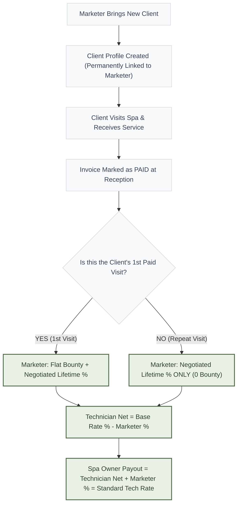
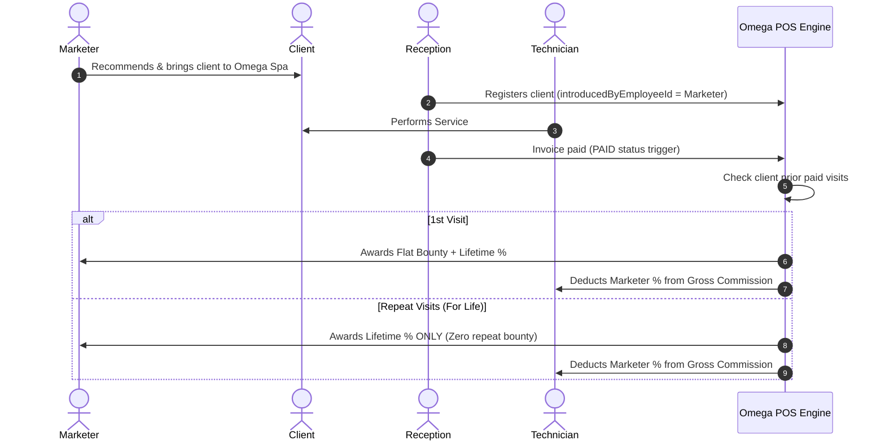

# OMEGA SPA — Marketer Compensation & Technician Deduction System

---

### Executive Summary

The **Marketer Compensation Engine** is built strictly around your core business rule:
1. **New Client Acquisition:** The marketer receives a one-time flat bounty fee on the new client's first paid invoice.
2. **Lifetime Recurring Split:** Every time that client returns for services in the future, the marketer earns a lifetime negotiated percentage.
3. **Zero Extra Cost to the Spa Owner (100% Payout Neutral):** The marketer's percentage is deducted directly from the technician who performs the service. Total spa payout never exceeds the standard technician commission rate.

---

### System Architecture Flowchart

---

### 1. How to Set Up Rates in the System (POS Staff Management)

All percentages and bounties are **fully dynamic and customized per staff contract**:

#### A. Setting the Technician's Commission Rate
1. Go to **Staff Management** (`/staff`).
2. Click **Contract** next to any technician.
3. Enter their contracted **Technician Service Commission Rate (%)** (e.g., `15%`, `20%`).
4. Click **Save Contract**.

#### B. Setting the Marketer's Agreement
1. Go to **Staff Management** (`/staff`).
2. Click **Contract** next to any marketer.
3. You will see 3 dedicated fields:
   * **Lifetime Commission Rate (%):** The percentage deducted from technicians for every visit by their clients (e.g., `2%`, `3%`, `4%`).
   * **New Client Flat Bounty (FCFA):** The one-time cash bonus awarded on the client's first paid checkout (e.g., `1,000 FCFA` or `2,500 FCFA`).
   * **Monthly Sales Target Quota (FCFA):** Revenue target to track performance on their monthly dashboard (e.g., `500,000 FCFA`).
4. Click **Save Contract**.

---

### 2. Step-by-Step Operational Lifecycle

---

### 3. Clear Real-World Calculation Examples

#### Example 1: Standard Service (4,000 FCFA)
* **Service:** Manicure / Express Styling (`4,000 FCFA`)
* **Technician Base Rate:** `20%`
* **Marketer Negotiated Rate:** `4%`
* **Marketer Flat Bounty:** `1,000 FCFA`

$$\begin{aligned}
\text{Total Commission Pool (20\%)} &= 4,000 \times 20\% = \mathbf{800\text{ FCFA}} \\
\text{Marketer Service Share (4\%)} &= 4,000 \times 4\% = \mathbf{160\text{ FCFA}} \\
\text{Technician Net Commission (16\%)} &= 800 - 160 = \mathbf{640\text{ FCFA}}
\end{aligned}$$

| Visit Type | Marketer Payout | Technician Payout | Spa Owner Total Expense |
| :--- | :--- | :--- | :--- |
| **1st Visit** | `1,000 FCFA` (Bounty) + `160 FCFA` (%) = **`1,160 FCFA`** | **`640 FCFA`** | `1,000` bounty + `800` service pool |
| **2nd Visit (Repeat)** | `0 FCFA` (Bounty) + `160 FCFA` (%) = **`160 FCFA`** | **`640 FCFA`** | **`800 FCFA`** (Exact 20% pool) |
| **10th Visit (Repeat)**| `0 FCFA` (Bounty) + `160 FCFA` (%) = **`160 FCFA`** | **`640 FCFA`** | **`800 FCFA`** (Exact 20% pool) |

---

#### Example 2: Luxury Treatment (20,000 FCFA)
* **Service:** Signature Luxury Facial (`20,000 FCFA`)
* **Technician Base Rate:** `15%` (`3,000 FCFA` gross)
* **Marketer Negotiated Rate:** `2%` (`400 FCFA`)
* **Marketer Flat Bounty:** `2,500 FCFA`

$$\begin{aligned}
\text{Technician Net Commission} &= 15\% - 2\% = \mathbf{13\%}\quad(2,600\text{ FCFA}) \\
\text{Marketer Service Percentage} &= \mathbf{2\%}\quad(400\text{ FCFA}) \\
\text{Total Service Payout} &= 2,600 + 400 = \mathbf{3,000\text{ FCFA}}\quad(15\%)
\end{aligned}$$

| Visit Number | Marketer Receives | Technician Receives | Owner Service Cost |
| :--- | :--- | :--- | :--- |
| **Visit 1 (New)** | `2,500 FCFA` bounty + `400 FCFA` (2%) = **`2,900 FCFA`** | **`2,600 FCFA`** (13%) | `3,000 FCFA` (15%) |
| **Visit 2 (Repeat)** | **`400 FCFA`** (2% lifetime) | **`2,600 FCFA`** (13%) | `3,000 FCFA` (15%) |
| **Visit 50 (Years later)** | **`400 FCFA`** (2% lifetime) | **`2,600 FCFA`** (13%) | `3,000 FCFA` (15%) |

---

### 4. Key Guarantees & Built-In Safety Rules

1. **Idempotent & Payment-Triggered:** Commissions are generated **only after an invoice status becomes `PAID`**. If an appointment is cancelled or refunded, zero commission is paid.
2. **Negative Balance Guard:** The deduction is capped at the technician's gross commission (`Math.min`), ensuring a technician can never earn negative commission.
3. **Multi-Technician Support:** If a client receives a Facial from Technician A and Nails from Technician B in the same visit, the marketer's % is deducted accurately from each technician's respective service.
4. **Complete Audit Trail:** Every technician commission ledger records an explicit note explaining the deduction: *(Referral deduction: -X FCFA for Marketer lifetime attribution)*.
